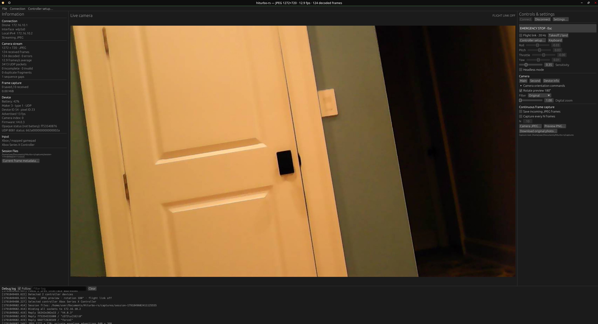

# Hiturbo-rs




Replimentation of the HiTurbo fpv drone protocol to rust.

This code was reverse engineered based on the behavour of the android app and contains no hiturbo proprietary code.

I currently only tested this on linux and macos, so it may not work on windows.

# Features
- Support for xbox controller and radiomaster controllers
- Live camera feed
- Ability to capture frames from the feed
- Statistics
- Reimpimentation of the control protocol

# How to use

You must have a network device that is connected to the hiturbo's wifi network (it communicates over wifi)

Once on the network, you should just be able to click connect, if that doesnt work, check the settings, you may have the wrong interface selected.

If it does not work, you may have to change the ip.

My drone was consistently on 172.16.10.1, but you can change that in settings in case its wrong.

Once connected, you should be able to see a live feed on the preview.

Also do not build the app in debug as the json decoder will fall behind (I think serde_json uses cpu decoding or something on debug builds)

# Disclaimers or Things that need testing

I never tested the battery scale and just assumed it returned a percentage, if you have more battery data and know for sure what the battery field is saying, let me know

The json stream appeared to be upside down, so I just flipped it. If this was a mistake (my drone is a probably cheap clone of a hiturbo) then click the rotate 180 button

There are some random "status" fields that were returned, so I just put the raw hex on the side. Same with the vendor and other fields, if anyone can figure out what these actually mean, please tell me so I can fix the ui.

# How to get xbox controllers working

1) click controller setup on the side
2) Select the controller (if its not appearing try hard wiring the controller, xbox has weird bluetooth driver issues, especially on linux)
3) Once its selected, press use device
4) Try moving the joysticks and seeing if the sliders update, if they do, try connecting the drone and flying

The software also supports radiomaster/other fpv radio controllers via the checkbox, but this is relativley untested to use at your own risk.


# How to capture video/images

Click the buttons on the side, the software does not support video output and just outputs the raw jpeg sequence, you can use a tool like ffmpeg to combine them into a video.

Here is such a command, it assumed the framerate is 14 (which is what my drone outputs)

Please run the following in the directory with all the jpegs:

```bash
ffmpeg -framerate 14 -pattern_type glob -i '*.jp*g' -c:v libx264 -pix_fmt yuv420p output.mp4
```

Please note you need the ffmpeg cli installed to run it, and it will output to a file called "output.mp4" which is also in the current directory.


# How do I install this?

For linux, do the following

```bash 
cargo install --path .
```

This will install the tool in the cli as `hiturbo-rs`

To install it as a desktop shortcut/in your app launcher, use the .desktop file provided.


  